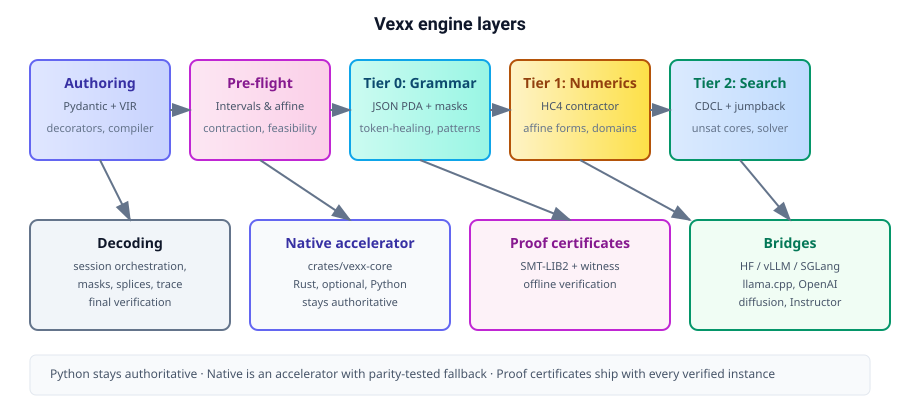

#  Veritas

**Solver-guided generation you can verify.**

Veritas turns a Python/Pydantic schema plus a small constraint DSL into a compiled
specification, then enforces it at every layer of generation: a JSON grammar PDA masks
tokens, interval/affine contractors prune numeric domains, zero-degree-of-freedom fields
are spliced without sampling, CDCL-style conflict analysis backtracks, and every returned
instance is verified concretely before it reaches you — shipping with a self-contained
proof certificate.

Pure Python reference engine with an optional dependency-free Rust accelerator
(`crates/veritas-core`), PyPI installable, Apache-2.0.

<div align="center">

[](https://pypi.org/project/veritas-ai/)
[](https://pypi.org/project/veritas-ai/)
[](https://opensource.org/licenses/Apache-2.0)
[](https://github.com/sahil-gaikwad94/veritas../actions)
[](docs/NATIVE.md)
[](https://github.com/sahil-gaikwad94/veritas..)

[Install](#install) • [Features](#features) • [Quick start](#quick-start) • [Examples](#examples) • [Architecture](#architecture) • [Docs](#docs)

</div>

---

## Table of contents

- [What Veritas does](#what-veritas-does)
- [✨ Features](#-features)
- [📦 Install](#-install)
- [🚀 Quick start](#-quick-start)
- [📚 Examples](#-examples)
- [🏗️ Architecture](#-architecture)
- [🧩 Domain cartridges](#-domain-cartridges)
- [🌉 Bridges](#-bridges)
- [📜 Proof certificates](#-proof-certificates)
- [🛠️ Runtime policies and tools](#-runtime-policies-and-tools)
- [🖥️ Command line](#-command-line)
- [🧪 Testing & CI](#-testing--ci)
- [⚠️ Status and limits](#-status-and-limits)
- [🤝 Use Veritas if](#-use-veritas-if)
- [🔗 Links](#-links)
- [📄 License](#-license)

---

## What Veritas does

Most LLM generators produce JSON and *hope* it matches your schema. Veritas does the
opposite: it starts from a schema you trust and constrains decoding so the model can only
emit valid instances — then proves it.

1. **Author** a Pydantic model and declarative constraints (`require`, `derive`, `prefer`,
   `forall`).
2. **Compile** them into VIR, a verifiable intermediate representation.
3. **Generate**: a JSON PDA masks illegal tokens at every step; numeric contractors prune
   impossible domains; CDCL backtracking recovers from dead ends.
4. **Verify** concretely: every constraint is re-evaluated on the final object before it is
   returned.
5. **Ship proof**: a self-contained certificate (VIR + witness + SMT-LIB2 + SHA-256) that
   anyone can verify offline.

The result: structured generation that cannot lie, with an audit trail you can file away.

---

## ✨ Features

| Feature | What it gives you |
|---|---|
| 🔒 **Verified schemas** | Pydantic + `require`/`derive`/`prefer`/`forall` compiled into VIR; contradictions fail before generation. |
| 🎭 **JSON PDA masking** | Exact token masks over your vocabulary — not a heuristic character check. Strings masked by `minLength`/`maxLength` *and* JSON-Schema `pattern`. |
| 🔢 **Numeric contractors** | Interval/affine (HC4) domain pruning with outward rounding; never reports a feasible equality as empty due to float error. |
| ↩️ **CDCL backtracking** | Conflict-directed jumpback and tabu prefixes recover from dead ends instead of failing the whole attempt. |
| ⚡ **0-DoF splicing** | Ready fields derived and spliced without sampling; canonical JSON Jump-Forward splices. |
| 📜 **Proof certificates** | Self-contained SMT-LIB2 + witness certificates with SHA-256 hashes, offline verification, tamper detection. |
| 🦀 **Rust accelerator** | `crates/veritas-core` — dependency-free, 17.9x faster token masking, pure-Python fallback on every call. |
| 🔌 **Model bridges** | HF / vLLM / SGLang / llama.cpp logits processors, async stream proxy, Gumbel-max diffusion, OpenAI/Instructor proxy. |
| 🧩 **Domain cartridges** | `quant`, `sql`, `sec`, `or_sched`, `stat`, `phys`, `chem`, `code` — deterministic reference checks, no mandatory NumPy/z3/SymPy. |
| 🖥️ **CLI** | `check-spec`, `verify`, `verify-proof`, `inspect`, `synth`, `doctor`, `export-rl`, `explain-unsat`, `serve` — compile, verify, prove, and diagnose from the terminal. |
| 🧮 **KL-distortion receipts** | `result.receipt()` — per-field KL divergence introduced by masking (`-log(accepted probability mass)`), content hashes and budget counters. |
| 🪪 **MCP firewall** | `vt.VeritasMcpSession` / `@verified_tool` — LTLf temporal masking of tool picks, symbolic env binding (`last_*`), spend caps, taint tracking on untrusted strings. |
| 🧪 **Minimal relaxation wizard** | `veritas explain-unsat` — pinpoints the minimal single-clause widening/raising or proves the conflict is structural. |
| 🚆 **TRL export** | `veritas export-rl` — decoder traces → DPO/GRPO JSONL with SHA-256 manifests for local fine-tuning. |
| 🧱 **Reverse proxy** | `veritas serve` — OpenAI-compatible `/v1/chat/completions` in front of an upstream; non-streaming responses are re-verified (422 on violation), streaming responses carry a `veritas_certificate`. |

---

## 🆕 Veritas 1.5 in 30 seconds

```python
import veritas as vt

# 1. Re-verified receipts: per-field KL distortion + content hashes
result = vt.generate(model=model, prompt="port", spec=portfolio)
print(result.receipt())
# {'sha256': ..., 'status': 'PASS', 'field_kl_divergence': {'weight_a': 3.47, ...}, ...}

# 2. The MCP firewall for agent tool calls
session = vt.VeritasMcpSession(temporal_policy=vt.before("lookup_order", "issue_refund"))

@session.verified_tool(name="issue_refund", requires_taint_free=True)
def issue_refund(args, state):
    # Later tool arguments see earlier tool outputs as symbolic bounds.
    vt.mcp.mcp_require(args.refund_amount <= state.env["last_order_total"])
    return {"refunded": args.refund_amount}

# 3. Terminal tooling
#   veritas explain-unsat schema.py   # minimal slack that repairs an UNSAT spec
#   veritas export-rl traces.jsonl --format dpo -o train.jsonl
#   veritas serve --upstream http://localhost:11434/v1 --spec-module schemas.py --port 8080
```

Full notes: [docs/1.5-release.md](docs/1.5-release.md).

---

## 📦 Install

```bash
pip install veritas-ai
```

Pure Python — no Rust toolchain required. Optional extras:

| Extra | Installs | For |
|---|---|---|
| `.[z3]` | `z3-solver>=4.13` | SMT oracle |
| `.[cas]` | `sympy>=1.12`, `numpy>=1.26` | CAS / numeric helpers |
| `.[rl]` | `datasets>=2.0`, `transformers>=4.40` | HuggingFace dataset export (DPO/GRPO) |
| `.[dev]` | `pytest>=8`, `hypothesis>=6`, `ruff>=0.6`, `build>=1.2` | Development & testing |

Source-tree development without installation:

```bash
git clone https://github.com/sahil-gaikwad94/veritas..git
cd veritas..
python -m venv .venv
.venv/bin/pip install -e ".[dev]"
PYTHONPATH=python .venv/bin/veritas --help
```

Optional native Rust accelerator (installed separately, used only as an accelerator — Python stays authoritative):

```bash
# Build the wheel
maturin build --release -m crates/veritas-py/Cargo.toml -o dist
pip install --no-deps dist/*.whl
```

See [`docs/NATIVE.md`](docs/NATIVE.md) for the accelerator contract, wire protocol, and
parity guarantees.

---

## 🚀 Quick start

### A schema that cannot lie

```python
import veritas as vt
from pydantic import BaseModel, Field


class Portfolio(BaseModel):
    weights: dict
    expected_return: float
    volatility: float
    sharpe_ratio: float


COV = {
    ("AAPL", "AAPL"): 0.048,
    ("AAPL", "MSFT"): 0.031,
    ("AAPL", "NVDA"): 0.042,
    ("MSFT", "MSFT"): 0.039,
    ("MSFT", "NVDA"): 0.036,
    ("NVDA", "NVDA"): 0.095,
}
RET = {"AAPL": 0.14, "MSFT": 0.13, "NVDA": 0.24}


@vt.verified_schema()
def portfolio(p: Portfolio):
    vt.require(vt.keys_subset(p.weights, {"AAPL", "MSFT", "NVDA"}))
    vt.require(vt.sum(p.weights.values()) == 1.0, tol=1e-6)
    vt.require(vt.forall(p.weights.values(), lambda w: (0.05 <= w) & (w <= 0.50)))
    vt.derive(p.expected_return == vt.dot(p.weights, RET), tol=1e-5)
    vt.derive(p.volatility == vt.sqrt(vt.quad_form(p.weights, COV)), tol=1e-5)
    vt.derive(p.sharpe_ratio == (p.expected_return - 0.04) / p.volatility, tol=1e-5)


report = portfolio.verify(
    {"weights": {"AAPL": 0.40, "MSFT": 0.35, "NVDA": 0.25}}
)
assert report.status == "PASS"
print(report.values)          # derived fields were filled
print(report.spec_digest)     # stable specification hash
```

`FAIL` reports include the violated constraints, residuals, a minimal unsat core and
relaxation hints. `INCOMPLETE` (missing or not-yet-evaluable fields) is never treated as a
pass. `report.raise_if_failed()` raises `vt.VerificationError` for guards and tools.

### Solver-guided generation

```python
from veritas.testing import StructuredReasoningModel
import veritas as vt

model = StructuredReasoningModel()      # deterministic mock; any next_logits adapter works
result = vt.generate(model=model, prompt="produce a portfolio", spec=portfolio)

print(result.raw)                       # exact JSON that was decoded
print(result.value)                     # validated model (or values dict)
print(result.report.status)             # verified before the result is returned
```

The engine is model-agnostic: a model exposes
`next_logits(prefix_text) -> Mapping[str, float]`. `veritas.testing` supplies deterministic
character models for tests; the bridges package adapts real HF, vLLM, SGLang and
llama.cpp tokenizers.

---

## 📚 Examples

<details>
<summary>Verify a portfolio instance</summary>

```bash
python -m veritas verify path/to/schema.py instance.json --json
```
Exit 0 only for `PASS`.
</details>

<details>
<summary>Build and verify a proof certificate</summary>

```python
certificate = vt.build_certificate(portfolio, {"weights": {"AAPL": 0.4, "MSFT": 0.35, "NVDA": 0.25}})
assert vt.verify_proof(certificate).ok

certificate.save("proof.json")
assert vt.verify_proof("proof.json").ok
```

A certificate embeds the versioned VIR, the witness, an SMT-LIB2 rendering and SHA-256
hashes. Verification is offline and re-evaluates the constraints from the embedded spec.
</details>

<details>
<summary>Compile a schema and run the feasibility gate</summary>

```bash
python -m veritas check-spec path/to/schema.py --json
```
</details>

<details>
<summary>Inspect a decode trace</summary>

```bash
python -m veritas inspect trace.json --out report.html
```
Renders a standalone HTML report from a decode trace.
</details>

<details>
<summary>Synthesize a schema from JSON examples</summary>

```bash
python -m veritas synth --from-json examples.json --out generated_schema.py
python -m veritas check-spec generated_schema.py
```
</details>

<details>
<summary>Doctor: check the live engine</summary>

```bash
python -m veritas doctor           # human-readable
python -m veritas doctor --json    # for a bug report
python -m veritas doctor --strict  # exit 1 unless the native extension is loaded
```
</details>

---

## 🏗️ Architecture

<p align="center">
  
</p>

| Layer | Modules | Responsibility |
|---|---|---|
| Authoring | `decorators.py`, `compiler/` | Compile Pydantic models + `require/derive/prefer/forall` into VIR; dependency graph; container analysis |
| Pre-flight | `compiler/preflight.py`, `analysis.py`, `linear.py` | Interval contraction, AGDecode container feasibility, exact affine feasibility, exact strict-bound refutation, checked string/pattern witnesses; contradictory specs fail before generation |
| Tier 0 grammar | `json_pda.py`, `pda.py`, `pattern.py`, `textformats.py` | Deterministic JSON pushdown automaton, exact token masks over a vocabulary, canonical rendering, incremental `pattern`/length string masks, verified witnesses for JSON-Schema `format` strings |
| Tier 1 numerics | `interval.py`, `linear.py`, `crane_mode.py` | Affine forms, HC4 contractor, residual containers, clause simplification |
| Tier 2 search | `nano_solver.py`, `cdcl_jumpback.py` | Deterministic linear solver with unsat cores, CDCL conflict branches, tabu prefixes |
| Acceleration | `zero_dof.py`, `token_healer.py` | Ready-field derivation, canonical JSON Jump-Forward splices, boundary healing |
| Native engine | `crates/veritas-core` | Dependency-free Rust ports of every layer above: intervals, JSON automaton, tri-state evaluator, HC4 contractor, exact solver, CRANE, CDCL jumpback, 0-DoF splicing, token healing, SMT-LIB emission. Used as an accelerator; Python stays authoritative |
| Decoding | `decode.py` | Session/engine orchestration, masks, splices, final verification, telemetry and trace |
| Verification | `evaluate.py`, `instance.py` | Total concrete evaluator, tri-state logic, derived fill, reports, minimal cores |
| Proofs | `proof/certificate.py` | Self-contained SMT-LIB2 + witness certificates, hashes, offline verification, tamper detection |
| Domain logic | `cartridges/` | Portfolio math, SQL safety, tool policies, scheduling, statistics, dimensional analysis, SMILES, code guardrails |
| Integrations | `bridges/` | HF/vLLM/SGLang/llama.cpp masking, aborting async streams, Gumbel-max diffusion, OpenAI proxy |
| Ecosystem | `ltlf.py`, `rl/`, `cli/`, `synth.py` | Finite-trace policies, DPO/GRPO exports, commands, schema synthesis |

### What the tiers guarantee

- **Tier 0** rejects any token that would make the JSON prefix unparsable, and allows EOS
  only when the document is complete. The mask is computed against the supplied vocabulary;
  it is not a heuristic character check. String fields are masked by `minLength`/
  `maxLength` *and* by their JSON-Schema `pattern`: `pattern.py` compiles the regex to a
  Thompson NFA and reports exactly which characters keep the prefix extendable. Patterns
  outside the maskable subset (inline flags, backreferences, lookaround, word boundaries)
  are rejected loudly and fall back to length-only masking with an entry in
  `telemetry["pattern_fallbacks"]`, so the final verifier — never the mask — has the last
  word. Formatted strings (`datetime`, `date`, `time`, `timedelta`, `UUID`, `Decimal`,
  `HttpUrl`, IP addresses, and `Field(json_schema_extra={"format": ...})`) are decoded from
  a *verified* witness per format: every candidate is re-checked with the concrete format
  checker, so `format: "date-time"` fields can be generated at all instead of failing as
  unsupported types. Unknown formats fall back to ordinary string masking and are listed in
  `telemetry["format_fallbacks"]`.
- **Tier 1** contracts numeric domains and dynamic-container residual sums. Contradictions
  restore the previous domain snapshot instead of poisoning the search. Contraction is
  outward-rounded, so a feasible equality such as `a + b == 1` can never be reported empty
  because of float error. Open (`gt`/`lt`) bounds are represented by the adjacent
  representable value for reals and by the neighbouring integer for ints, and the excluded
  endpoint is refused at the stop decision as well as in the contractor. Open bounds are
  *also* enforced for container elements (`forall(lst, lambda v: 0 < v < 1)`).
- **Numeric search** is a bounded depth-first walk over digits and `.`/`-`, ordered by model
  logits and pruned by the reachable interval, with a deterministic interior fallback when
  the budget runs out. A greedy literal that leads to a dead end is abandoned for a
  feasible sibling instead of failing the whole attempt.
- **Tier 2** only returns `UNSAT` when it can prove it; budget/timeout yields `UNKNOWN`.
- **Final verification** evaluates every constraint on the concrete object. A generated
  result is returned only if the report is `PASS`; if decoding exhausts its budget, the
  engine emits a canonical valid object rather than truncated JSON. Structural failures
  (missing required field, wrong type, pattern mismatch) are reported as concrete
  `outcomes` naming the offending field, so `VerificationError` says *what* to fix instead
  of "0 satisfied, 0 violated, 0 unevaluated".
- **Soft preferences** (`vt.prefer`) steer generation: after a `PASS`, violated soft bounds
  are intersected into the declared domain and the attempt is repeated while the weighted
  preference score improves. Preferences never override hard constraints, and the accepted
  result is the best-scoring verified one (`telemetry["preference_score"]`).

Equality tolerances are applied at final verification, while contractor cuts use exact
bounds. This avoids the classic false-infeasibility bug where an epsilon-padded cut rejects
a feasible instance.

---

## 🧩 Domain cartridges

Deterministic reference implementations with no mandatory NumPy/z3/SymPy dependency.

| Cartridge | Concrete checks |
|---|---|
| `quant` | Simplex/concentration limits, covariance PSD, Cholesky, portfolio stats, Black–Scholes call/put, implied volatility by bisection, no-arbitrage bounds, GAAP/cash-flow identities |
| `sql` | Real tokenization, table/column/alias resolution, declared foreign-key joins, required tenant predicates, read-only enforcement, structural warnings for constructs it cannot verify |
| `sec` | Declared tools, preconditions/effects, budgets, snapshots, LTLf policy evaluation |
| `or_sched` | Precedence DAG with cycle detection, earliest-start solver, deadlines/releases, interval-capacity overload detection, critical path |
| `stat` | Probability simplex, Fréchet bounds, Bayes consistency, covariance PSD, d-separation via ancestral moral graphs |
| `phys` | Rational-exponent dimensional algebra, AST equation checking, unit-aware quantities, transcendental-function dimension checks |
| `chem` | SMILES tokenizer/parser, branches, ring closures, charges, implicit hydrogens, valence limits, formula and molecular weight |
| `code` | Scope-aware undefined-identifier detection, literal division by zero, literal index bounds, syntax errors |

The core DSL and numerical helpers use pure-Python reference paths.

---

## 🌉 Bridges

- **HuggingFace / vLLM / SGLang / llama.cpp**: build an exact JSON token mask from the
  tokenizer vocabulary and attach it as a logits processor. The processors accept lists,
  NumPy arrays and torch tensors. llama.cpp hosts that only accept a grammar string get a
  generic JSON GBNF; if a spec is supplied, that path fails closed rather than pretending
  the generic grammar enforces the spec.
- **Async stream proxy**: supervises raw text, SSE `data:` frames and OpenAI/Anthropic delta
  objects. It raises on malformed prefixes, incomplete termination and final spec violations,
  with an optional violation callback.
- **Diffusion**: Gumbel-max sampling and confidence-ordered unmasking.
- **OpenAI/Instructor**: `patch_openai(client, spec=...)` injects the VIR payload, requests a
  JSON schema, verifies the returned JSON and raises `VerificationError` on failure.

The bridge tests use deterministic fake tokenizers/clients. They validate the adapter logic,
not a live vendor deployment.

---

## 📜 Proof certificates

```python
certificate = vt.build_certificate(portfolio, {"weights": {"AAPL": 0.4, "MSFT": 0.35, "NVDA": 0.25}})
assert vt.verify_proof(certificate).ok

certificate.save("proof.json")
assert vt.verify_proof("proof.json").ok
```

A certificate embeds the versioned VIR, the witness, an SMT-LIB2 rendering and SHA-256
hashes. Verification is offline and re-evaluates the constraints from the embedded spec.
The SMT export reports its coverage explicitly (`smt2_complete`, `smt2_omitted`); omitted
constraints are still checked by the VIR evaluator.

These hashes are **unkeyed integrity checks, not authentication**. Anyone can recompute
them, so bind verification to a trusted spec with `vt.verify_proof(cert, expected_spec=...)`
or sign the artifact in your application. Arbitrary Python/Pydantic validators are not
portable; certificates for non-portable schemas require the original trusted schema to
re-run those validators.

---

## 🛠️ Runtime policies and tools

`vt.WorldState` models declared tools, preconditions, effects and budgets. Tool calls are
recorded, preconditions are checked before execution, and finite-trace LTLf policies
(`always`, `eventually`, `before`, `responds`, `at_most`, `never`) can reject a trace after
the fact. `vt.verified_tool(spec=..., world_state=...)` verifies a tool's return value before
the caller sees it and can attach a proof.

```python
from veritas.ltlf import always, before
from veritas.cartridges.sec import WorldState

state = WorldState()
state.assert_fact("authenticated")
state.before_tool_call("transfer", {"amount": 10})
```

---

## 🖥️ Command line

```bash
# Compile a schema and run the 0-token feasibility gate.
python -m veritas check-spec path/to/schema.py --json

# Verify a JSON instance; exit 0 only for PASS.
python -m veritas verify path/to/schema.py instance.json

# Re-verify a proof certificate offline; exit 0 only when every check passes.
python -m veritas verify-proof proof.json

# Render a decode trace to a standalone HTML report.
python -m veritas inspect trace.json --out report.html

# Infer a schema module from JSON examples, then compile the generated module.
python -m veritas synth --from-json examples.json --out generated_schema.py
python -m veritas check-spec generated_schema.py

# Report the live engine: reference or accelerated, wire version, platform.
python -m veritas doctor           # human-readable
python -m veritas doctor --json    # for a bug report
python -m veritas doctor --strict  # exit 1 unless the native extension is loaded

# Minimal repair for an infeasible spec: per-clause minimal slack, or "structural".
python -m veritas explain-unsat schema.py [--json]

# Export decoder traces as TRL-ready preference data (DPO or GRPO).
python -m veritas export-rl traces.jsonl --format dpo -o train_dpo.jsonl
python -m veritas export-rl traces.jsonl --format grpo -o train_grpo.jsonl

# OpenAI-compatible verification reverse proxy for structured outputs.
veritas serve --upstream http://127.0.0.1:11434/v1 --spec-module schemas.py --spec portfolio --port 8080

# Trace capture: DecodeConfig(rl_trace_path="traces.jsonl") persists conflict-branch
# records (with the repaired completion attached once the run verifies).
```

`--from-doc` is deliberately explicit about requiring a model adapter rather than pretending
to infer from prose.

---

## 🧪 Testing & CI

```bash
PYTHONPATH=python .venv/bin/python -m pytest tests/ -q
```

Current status: **425 passed, 41 skipped** in the default install (compiler, preflight,
instance verification, JSON PDA, token healing, decode engine, pattern masking (including
word-boundary assertions), numeric search, structural diagnostics, proofs, cartridges,
bridges, LTLf/RL, the MCP firewall, receipts, explain-unsat, export-rl and CLI/proxy
end-to-end). The 41 skips are the native/pure-Python parity corpus, the kill-switch tests
that need a live engine, and the randomized differential sweep in `tests/test_native_backend.py`;
with the extension built they run, so the whole suite is **466 passed, 0 skipped** *and*
every other test then exercises the native masks and numeric prefixes.

The Rust engine has its own 69 unit tests plus 12 property tests
(`crates/veritas-core/tests/soundness.rs`) that refutes randomized constraints against a
brute-force grid, re-checks every UNSAT core standalone and cross-checks the automaton against
the prefix classifier. CI runs:

```bash
cargo test -p veritas-core --all-targets
cargo clippy -p veritas-core --all-targets -- -D warnings
cargo build --release -p veritas-py
cargo build -p veritas-wasm --target wasm32-unknown-unknown
```

Useful focused suites:

```bash
.venv/bin/python -m pytest tests/test_instance_verification.py -q
.venv/bin/python -m pytest tests/test_decode_engine.py -q
.venv/bin/python -m pytest tests/test_pattern.py tests/test_numeric_search.py -q
.venv/bin/python -m pytest tests/test_text_formats.py -q
.venv/bin/python -m pytest tests/test_decode_robustness.py -q
.venv/bin/python -m pytest tests/test_proofs.py -q
.venv/bin/python -m pytest tests/test_bridges.py tests/test_cli_preflight.py -q
```

---

## ⚠️ Status and limits

- The **Python engine is the complete, tested product surface** in this repository; the Rust
  engine is a tested accelerator with the same semantics, not a replacement API.
- `crates/veritas-core` is dependency-free (no crates, no C toolchain) and its 68 unit tests,
  12 property tests, `clippy -D warnings`, the pyo3 build and the wasm build all run in CI.
  Using Veritas needs no Rust toolchain; every native claim here is backed by a CI run rather
  than a developer's local build.
- On a GitHub runner the accelerator is **17.9x** faster at `TokenMasker.valid_mask` over a
  605-token vocabulary and **1.5x** faster at `Interval.from_numeric_prefix` (4.07 ms → 0.23 ms
  and 5.7 µs → 3.9 µs per call); `benchmarks/native_speedup.py` reproduces the comparison and
  the numbers, caveats included, are in `docs/BENCHMARKS.md`; the accelerator's contract
  (build, wire format, fallback and panic behaviour, what is and is not accelerated) is
  `docs/NATIVE.md`. The first is a per-token loop, the
  second is a handful of float operations dominated by the call boundary.
- The native path is preferred only when `veritas.native.available()` is true, and every
  wrapper falls back to pure Python; `tests/test_native_backend.py` pins the parity, so a
  native regression costs speed, not soundness. `veritas.native.info()` reports the loaded
  engine and why it is missing otherwise. Set **`VERITAS_NO_NATIVE=1`** to force the reference
  path (checked per call, no reinstall), and run `python benchmarks/native_speedup.py` to see
  what the accelerator actually buys on your machine instead of trusting a headline number.
- The grammar tier recognizes **JSON**, not arbitrary context-free grammars. Schema-guided
  masking supports a documented JSON Schema subset (objects/arrays/scalars, `anyOf`/`oneOf`,
  local `$ref`, required/arity/range/enum); unsupported keywords fail loudly. Token masking
  is exact over a supplied vocabulary but is a Python reference implementation, not a SIMD
  kernel.
- `require` comparisons are exact by default; pass `tol=` explicitly when an engineering
  tolerance is intended. `derive` keeps a numeric equality tolerance by default.
- The certificate verifier is self-contained. The optional Z3 oracle is exercised when
  `z3-solver` is installed; SymPy/CAS paths remain optional.
- `pattern` masking covers a documented regex subset. Constructs that would need semantic
  case folding or unbounded lookaround (`(?i)`, backreferences, word boundaries, lookaround)
  are rejected and generation degrades to length-only masking with an explicit telemetry
  entry; the verifier then rejects any mismatch instead of silently accepting it. Only the
  first `pattern` on a field drives the mask when several are declared.
- Formats are generated from a witness table, not sampled character by character. A
  formatted field whose declared `minLength`/`maxLength` window excludes every candidate
  (or whose `pattern` contradicts the canonical witness) is reported in
  `format_fallbacks` and falls back to ordinary masking; the concrete validator decides.
- Numeric literals are bounded by `DecodeConfig.max_integer_digits`,
  `max_fraction_digits` and `max_number_nodes`. A schema whose only solutions need more
  digits than that is reported as a dead end (with the culprit field), not silently
  rounded into a violation.
- GPU/runtime bridges are adapter-tested with fakes. They are not integration-tested against
  live HF/vLLM/SGLang/llama.cpp servers, and vendor APIs may need host-specific wiring.
- `--from-doc` requires a model adapter and intentionally fails loudly instead of inventing a
  schema.

The design documents that drove the implementation are in
`Veritas Architecture And Math Spec.md`, `Veritas Api And Feature Handbook.md` and
`Veritas Implementation Blueprint And Prompts.md`.

---

## 🤝 Use Veritas if

**Use Veritas if** you need structured generation where correctness is non-negotiable:
financial portfolios, SQL that must pass read-only + tenant checks, tool calls with
preconditions, scheduling with deadlines, or any artifact that ships with a proof you can
archive and verify offline.

**Don't use Veritas if** you need unconstrained free-form generation, arbitrary context-free
grammars beyond JSON, or real-time SIMD-accelerated masking at massive vocabulary scale — the
grammar tier is JSON, and token masking is exact but a Python reference implementation
(accelerated for the two hot call sites by the optional Rust engine).

---

## 🔗 Links

- [PyPI: veritas-ai](https://pypi.org/project/veritas-ai/)
- [GitHub repository](https://github.com/sahil-gaikwad94/veritas..)
- [Issue tracker](https://github.com/sahil-gaikwad94/veritas../issues)
- [Native engine contract](docs/NATIVE.md)
- [Benchmarks](docs/BENCHMARKS.md)
- [Audit notes](docs/AUDIT.md)
- Design specs: [Architecture & Math](docs/specs/Veritas%20Architecture%20And%20Math%20Spec.md) • [API & Feature Handbook](docs/specs/Veritas%20Api%20And%20Feature%20Handbook.md) • [Implementation Blueprint](docs/specs/Veritas%20Implementation%20Blueprint%20And%20Prompts.md)

---

## 📄 License

Apache-2.0.

<p align="center">
  <a href="#top">Back to top</a>
</p>
